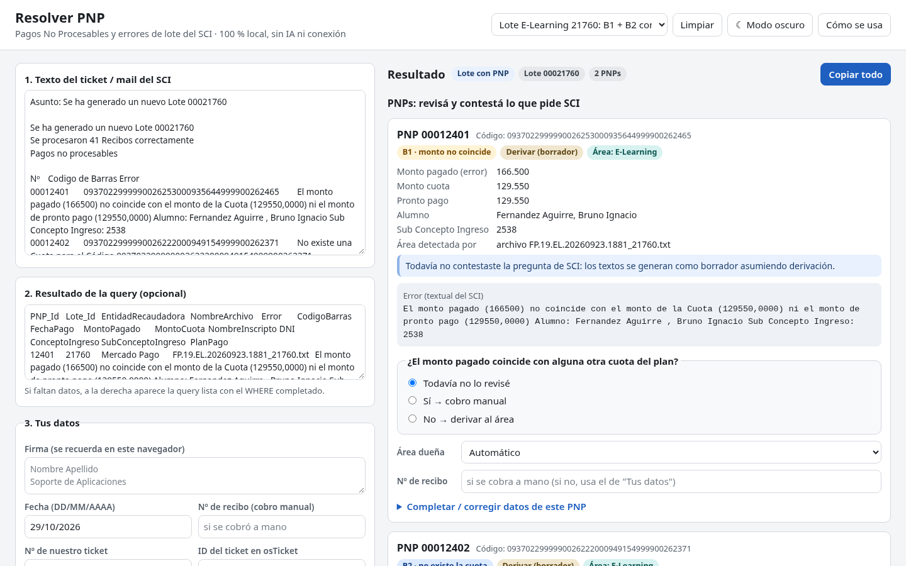
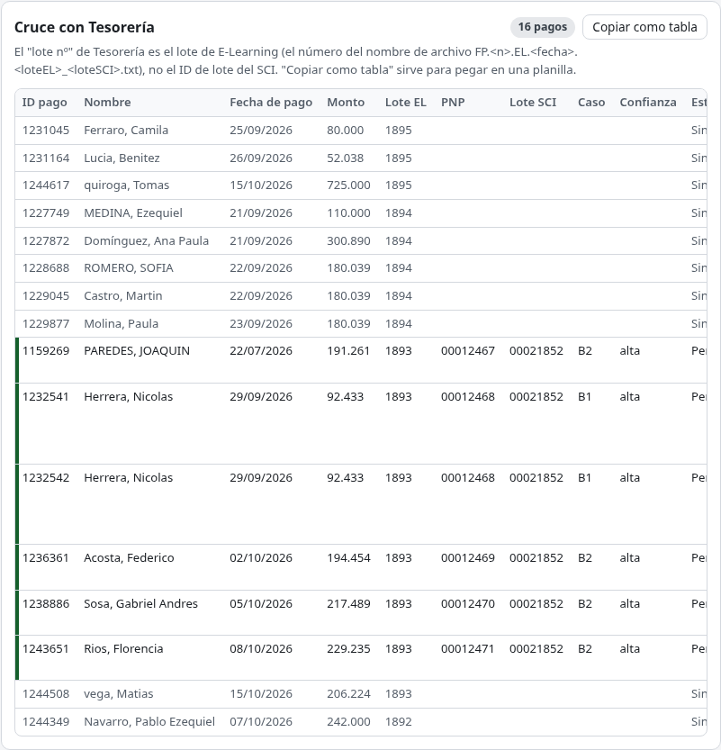

# Resolver PNP

Herramienta web **100 % offline** para resolver los **Pagos No Procesables (PNP)** y los **errores de lote** del Sistema de Control de Ingresos (SCI) de UTN.BA. Es un único archivo HTML: se abre con doble clic, no necesita instalación, no usa IA y no se conecta a internet.

Lee el mail o ticket automático del SCI, clasifica cada pago, te pregunta lo que solo se puede ver en SCI y arma los textos listos para copiar: el ticket a E-Learning, el mail al coordinador, la Descripción Resolución del PNP, la nota interna y la respuesta a Tesorería.



> Las reglas salen de la skill "resolver-pnp" ([`docs/SKILL.md`](docs/SKILL.md)), que documenta el procedimiento de Soporte de Aplicaciones. La herramienta lo replica de forma determinística: mismo caso, mismos textos.

---

## Índice

- [Contexto: qué es un PNP](#contexto-qué-es-un-pnp)
- [Cómo abrirlo](#cómo-abrirlo)
- [Cómo se usa](#cómo-se-usa)
- [Qué casos reconoce](#qué-casos-reconoce)
- [Cruce con el mensaje de Tesorería](#cruce-con-el-mensaje-de-tesorería)
- [Las queries (SSMS, DB SysAdmin)](#las-queries-ssms-db-sysadmin)
- [Qué textos genera](#qué-textos-genera)
- [Límites y privacidad](#límites-y-privacidad)
- [Mantenimiento: contactos, palabras clave y formato de Tesorería](#mantenimiento)
- [Desarrollo](#desarrollo)
- [Estructura del proyecto](#estructura-del-proyecto)

---

## Contexto: qué es un PNP

Todos los días hábiles entran al SCI los pagos de las entidades recaudadoras (Mercado Pago, Rapipago, Pago Fácil, VISA Home, Banelco…), agrupados en **lotes**. Cuando un pago no se puede asociar a una cuota queda como **Pago No Procesable**. El SCI manda un mail automático y Soporte de Aplicaciones tiene que decidir qué hacer con cada uno:

- **cobrarlo a mano**, si el monto coincide con alguna cuota;
- **derivarlo al área dueña** de la inscripción (E-Learning, Posgrado, SCEU, etc.), si no se puede impactar;
- o dejarlo **pendiente / irresoluble**, si no hay forma de saber a qué inscripción corresponde.

Esta herramienta hace el trabajo repetitivo: clasificar, identificar el área, detectar qué datos faltan y redactar los textos con el formato que usa el equipo.

## Cómo abrirlo

1. Descargá [`dist/resolver-pnp.html`](dist/resolver-pnp.html) (en GitHub: botón **Download raw file**).
2. Abrilo con doble clic en Chrome o Edge.

No hay que instalar nada y funciona sin conexión. Para actualizarlo, se reemplaza el archivo por la versión nueva.

Para practicar, el menú **Cargar ejemplo…** trae casos armados con datos de prueba: notificación de lote, errores de lote, cada tipo de PNP, un ticket de usuario y el cruce con Tesorería.

## Cómo se usa

La pantalla tiene dos columnas: a la izquierda lo que pegás, a la derecha el diagnóstico y los textos. Todo se recalcula mientras escribís.

### 1. Pegar el ticket o mail del SCI (cuadro 1)

Copiá el mail completo, asunto y cuerpo. Sirve copiado de osTicket, OTRS o del cliente de mail, con tabs, con espacios o todo en una línea. La herramienta detecta sola el tipo de ticket (ver [Qué casos reconoce](#qué-casos-reconoce)).

### 2. Revisar el diagnóstico y la tarjeta de cada PNP

Cada PNP tiene su tarjeta con:

- el **caso** (B1, B2, B3 o B4) y la acción sugerida;
- el **área dueña** y cómo se detectó (por nombre de archivo o por palabras clave). Si no se puede detectar, se elige a mano;
- los datos que se pudieron leer del error (monto pagado, monto de la cuota, alumno, subconcepto…);
- advertencias: **nombre con caracteres rotos** (hay que avisar a Soporte de Aplicaciones antes de cobrar), área indeterminada, datos faltantes.

### 3. Contestar las preguntas de SCI

Hay cosas que solo se ven en SCI. Cada PNP trae su pregunta:

| Caso | Pregunta |
|---|---|
| B1 · monto no coincide | ¿El monto pagado coincide con alguna otra cuota del plan? |
| B2 · no existe la cuota | ¿Aparece la cuota buscando por Cod. Barras en SCI? |
| B3 · cuota ya impactada | ¿Qué ves en la inscripción? (cuota siguiente igual, cuotas anteriores impagas, sin cuotas, monto distinto) |

Mientras la respuesta sea "Todavía no lo revisé", los textos salen como **borrador**, asumiendo que se deriva al área. Si contestás "Sí → cobro manual", aparece el checklist de cobro manual y la resolución pasa a "Se cobró manualmente. Recibo …".

### 4. Completar lo que falta

El mail del SCI no trae entidad recaudadora, nombre de archivo, fecha de pago, concepto ni plan de pago. Cuando faltan:

- a la derecha aparece la **query lista para correr**, con el `WHERE` ya completado. Se corre en SSMS y la grilla se pega en el **cuadro 2** ([detalle](#las-queries-ssms-db-sysadmin));
- o se escriben a mano en **Completar / corregir datos** de cada PNP. Lo que escribas ahí pisa lo detectado.

Todo hueco queda resaltado en amarillo como `[COMPLETAR: …]`, con un contador por texto.

### 5. (Opcional) Pegar el mensaje de Tesorería (cuadro 4)

Si Tesorería mandó la lista de pagos sin número de recibo, pegala en el cuadro 4 y la herramienta la cruza con los PNP. Ver [Cruce con el mensaje de Tesorería](#cruce-con-el-mensaje-de-tesorería).

### 6. Cargar tus datos y copiar

En **Tus datos** (cuadro 3) van tu firma (se recuerda en el navegador), la fecha, el Nº de recibo del cobro manual y el número e ID de nuestro ticket en osTicket. Con eso se completan los últimos huecos.

Cada texto tiene su botón **Copiar**, y arriba está **Copiar todo**.

## Qué casos reconoce

### Tipo de ticket

| Lo que llega | Qué hace la herramienta |
|---|---|
| "Se ha generado un nuevo Lote Nro…", carga de e-Learning, estado PENDIENTE | **Notificación de lote**: nada que resolver, cerrar sin encuesta. |
| "Se produjo un error al generar el Lote…" | **Error de lote**: causa y pasos según el error (duplicados, *Object reference*, cantidades/importes, período cerrado, cuotas pagas, archivo vacío). Si pegás el contenido del archivo, **detecta los códigos de barras duplicados**. Arma la nota del ticket. |
| "Se procesaron N Recibos… Pagos no procesables" + tabla | **Lote con PNP**: clasifica cada fila (ver abajo). |
| Mail de una persona con un comprobante | **Ticket de usuario**: arma la query para buscar el PNP por fecha, monto o texto. |
| Solo el mensaje de Tesorería | **Pedido de Tesorería**: lista los pagos y arma la query para encontrar sus PNP. |

### Casos de cada PNP

| Caso | Error del SCI | Resolución típica |
|---|---|---|
| **B1** | "El monto pagado (X) no coincide con el monto de la Cuota (Y)…" | Si coincide con otra cuota → cobro manual. Si no → derivar al área. |
| **B2** | "No existe una Cuota para el Código X" | Código de 40 dígitos: buscar en SCI; si no está → derivar. Código corto (ID de cuota) → **irresoluble**. Código en ceros → dejar registro. |
| **B3** | "La Cuota (N) ya se encuentra asociada al Recibo…" | Cobrar la cuota siguiente, o avisar al coordinador (cuotas anteriores impagas / sin cuotas). Equipos de fútbol → SAE Deportes. |
| **B4** | Cualquier otro error | Sin procedimiento documentado: describirlo y derivarlo a Soporte de Aplicaciones. No se inventa nada. |

### Área dueña

En orden de confiabilidad:

1. **Nombre de archivo del lote**: `FP.<n>.EL.<fecha>…` → E-Learning; `MP.SCEU.<fecha>…` → SCEU.
2. **Palabras clave** en concepto, subconcepto o alumno: Posgrado/Maestría/Especialización, TUNB/TSNB, APM, curso de seguridad, equipo de fútbol/Deportes.
3. Si no alcanza, se pide el nombre de archivo o se elige el área a mano.

## Cruce con el mensaje de Tesorería

El caso más difícil es **B2 con código de 40 dígitos**: la cuota no existe en SCI, así que la query no trae nombre, DNI ni concepto, y no hay forma de saber de quién es el pago. Tesorería ve esos pagos del lado de Mercado Pago / E-Learning y manda un mail con la lista: ID de pago, ID de orden, nombre, mail, fechas, montos y "En lote nº". El cuadro 4 hace solo el cruce que antes se hacía a mano.



**Qué acepta.** El mail tal como llega, con los mails en formato `[x](mailto:x)` o planos, con o sin líneas en blanco entre pagos, o copiado de una planilla con columnas separadas por tabs. Si una fila no se puede leer completa, se muestra igual con un aviso: nunca se descarta en silencio.

**Cómo cruza.** Para cada PNP y cada pago calcula un puntaje con señales que se muestran como "razones":

| Señal | Peso |
|---|---|
| Mismo lote EL (si los dos se conocen y son distintos, el par se descarta) | fuerte |
| Monto bruto = monto pagado del PNP (±1 peso) | fuerte |
| Suma de pagos de la misma orden o mail = monto pagado (ej. 184.866 = 2 × 92.433) | fuerte |
| Mismo nombre (sin importar orden, tildes ni mayúsculas) | fuerte |
| Misma fecha de pago (a 1 día: débil; distinta: resta) | media |
| Monto del pago = monto de la cuota | débil |

- La confianza resulta **alta**, **media** o **baja**. La asignación es uno a uno: un pago no puede quedar en dos PNP.
- Si dos candidatos empatan, la herramienta **no elige**: lo marca como **ambiguo** y muestra los dos, cada uno con su botón **Usar este pago**.

**Qué hace con un cruce.**

- **Confianza alta:** completa los datos vacíos del PNP (nombre, fecha, monto, mail; entidad "Mercado Pago" si falta), con fuente *Tesorería*. **Nunca pisa** un dato de la query o cargado a mano. El mail del alumno se agrega como "Mail inscripto" en el ticket a E-Learning y en el mail al coordinador.
- **Confianza media o baja:** no completa solo. La tarjeta muestra "Posible pago de Tesorería" con el botón **Usar estos datos**.
- **Suma de varios pagos:** avisa, por ejemplo: "El monto pagado (184.866) es la suma de 2 pagos de 92.433 de la misma orden: pagó dos cuotas en un mismo pago".

**Lote EL vs. lote SCI.** El "En lote nº 1893" de Tesorería **no es el ID de lote del SCI**: es el lote de E-Learning que figura en el nombre de archivo, `FP.<n>.EL.<AAAAMMDD>.<loteEL>[_<loteSCI>].txt`. Por ejemplo, `FP.19.EL.20260923.1881_21760.txt` es el lote EL 1881 y el lote SCI 21760. Si el lote SCI no tiene nombre de archivo pero un PNP cruzó con confianza alta por nombre, la herramienta **sugiere** "este lote SCI parece ser el lote EL 1893". No lo da por confirmado: hay que aceptarlo con un botón.

**Sin la query** los B2 no tienen monto ni fecha, así que no se pueden cruzar. La herramienta lo avisa y muestra la query que hay que correr.

**Salidas del cruce:**

- **Tabla de cruce:** una fila por pago, con el PNP, el lote SCI, el caso, la confianza, las razones y el estado de resolución según lo que contestaste en las preguntas de SCI. Tiene botón **Copiar como tabla** para pegar en una planilla.
- **Respuesta a Tesorería:** una línea por pago o grupo de pagos con su estado (cobrado con recibo, derivado, sin PNP…). Sale como borrador mientras haya algo sin revisar.
- **Nota interna:** una línea por PNP cruzado, por ejemplo "PNP 00012469: datos completados con el mensaje de Tesorería (pago 1236361, lote EL 1893)".

## Las queries (SSMS, DB SysAdmin)

La herramienta no se conecta a la base: arma las queries para que las corras vos.

**Datos faltantes.** Trae entidad, archivo, fecha, montos, nombre, DNI, concepto, subconcepto y plan de pago de los PNP del ticket. El `WHERE` sale completado (`pnp.LoteId = …` o `pnp.Id IN (…)`).

**PNP de los pagos de Tesorería.** Mismas columnas, filtrada por los lotes EL (`l.NombreArchivo LIKE '%.EL.%.1893[_.]%'`) y por los montos: cada pago y la suma de los pagos de una misma orden.

**Ticket de usuario.** Busca PNP por fecha de pago, monto o texto del error.

En todos los casos:

1. Copiá la query y corrila en SSMS, en la DB **SysAdmin**.
2. En la grilla de resultados: clic derecho → **Copy with Headers**.
3. Pegala en el **cuadro 2**. Acepta tabs, `;` o `,`.

En "No existe una Cuota" la query no trae nombre ni concepto, porque la cuota no está en SCI. El nombre sale del mensaje de Tesorería, de SysGestión, de Mercado Pago o del comprobante. Si no se consigue, esa línea se omite.

## Qué textos genera

| Texto | Cuándo |
|---|---|
| **Diagnóstico** | Siempre: qué caso es cada PNP y qué hay que hacer. |
| **Ticket a E-Learning** (Resumen + Descripción) | PNP de archivos `.EL.` que se derivan. Uno por lote, agrupado por tipo de error, con el estilo exacto del equipo. |
| **Mail al coordinador** | PNP de otras áreas. Lleva destinatario según el área y CCO a Soporte de Aplicaciones. |
| **Descripción Resolución del PNP** | Para el campo de SCI, con el valor de "¿Pendiente?". |
| **Nota interna** | Para el ticket de osTicket: una línea por PNP con estado, fecha y acción. |
| **Recordatorio de seguimiento** | Cuando se deriva: revisar en 5 días hábiles. |
| **Checklist de cobro manual** | Cuando algún PNP se cobra a mano. |
| **Nota de error de lote** | En errores de lote, con los códigos duplicados si se pegó el archivo. |
| **Tabla de cruce y respuesta a Tesorería** | Si se pegó el mensaje de Tesorería. |

Formato: fechas `DD/MM/AAAA`; montos con separador de miles (`166.500`, `1.234,50`); el error del SCI se copia textual.

## Límites y privacidad

- **No tiene acceso a SCI ni a la base de datos.** Las verificaciones las hacés vos y las contestás en las preguntas de cada PNP.
- **Nunca inventa** fechas, montos, nombres, recibos ni números de ticket. Lo que no sabe queda como `[COMPLETAR: …]`, `<NÚMERO>`, `<IDTICKET>`, `<NRO_RECIBO>` o `<FIRMA>`.
- **Sin red.** El HTML no hace ninguna llamada externa: hay una Content-Security-Policy que lo impide y el build falla si el código intenta usar la red.
- **No guarda datos de alumnos.** Solo recuerda tu firma y el tema claro/oscuro en el navegador (`localStorage`). El ticket, la query y el mensaje de Tesorería se pierden al cerrar la pestaña.
- **No incluye contraseñas.** La del portal de E-Learning está en la documentación interna.
- Los errores sin procedimiento documentado (B4, o un error de lote desconocido) solo se describen y se sugiere derivarlos a Soporte de Aplicaciones.
- **Los datos de los ejemplos y de los tests son ficticios.**

## Mantenimiento

Lo que cambia con el tiempo está todo en [`src/config.js`](src/config.js):

- **Áreas y contactos:** destinatarios de cada área, canal (mail o ticket) y CCO.
- **Reglas por nombre de archivo:** `.EL.` → E-Learning, `SCEU` → SCEU.
- **Palabras clave** para detectar el área por concepto o alumno.
- **Sección `tesoreria`:** a quién va dirigida la respuesta (`contacto`), las columnas del mail de Tesorería, la expresión de "En lote nº" y la tolerancia de montos. Si Tesorería cambia el formato, se ajusta acá sin tocar la lógica.

Después de editar, regenerá el HTML y repartilo de nuevo:

```bash
node build.mjs
```

Si cambia el procedimiento, actualizá primero [`docs/SKILL.md`](docs/SKILL.md), después el código y los tests.

## Desarrollo

Requisitos: **Node.js 18 o superior**. El proyecto no tiene dependencias de ejecución.

```bash
node --test          # tests: parser, clasificador, plantillas y cruce con Tesorería
node build.mjs       # genera dist/resolver-pnp.html (todo inline: CSS, JS y ejemplos)
```

**Prueba en el navegador (opcional).** Usa Chrome headless con Playwright. Carga todos los ejemplos y verifica el snapshot del ticket, el cobro manual, "Copiar todo", el cruce con Tesorería, el modo oscuro y que no haya desborde en celular, errores de consola ni requests de red:

```bash
cd tools
npm install
node e2e.mjs         # capturas en tools/capturas/ (no se versionan)
```

**Cómo está armado.** El código fuente son módulos ES en `src/`, en este orden: `config` → `parser` → `classifier` → `templates` → `ui`. `build.mjs` les saca los `import`/`export`, los concatena en un solo `<script>` junto con el CSS y los ejemplos de `tests/fixtures/ejemplos.json`, y escribe `dist/resolver-pnp.html`. Los tests importan los módulos directamente con Node.

Convenciones:

- JavaScript vanilla, sin frameworks ni librerías.
- Los textos de las plantillas salen literalmente de `SKILL.md`. Hay un snapshot del ticket de ejemplo que tiene que dar idéntico.
- Todo dato completado lleva su **fuente** (`query`, `error`, `manual`, `tesoreria`). Un dato de menor prioridad nunca pisa uno de mayor prioridad.

## Estructura del proyecto

```
src/
  config.js         contactos, reglas de área, palabras clave, formato de Tesorería
  parser.js         lectura del mail del SCI, de la grilla de la query y del mensaje de Tesorería
  classifier.js     tipo de ticket, casos B1-B4, área dueña, decisiones, faltantes, cruce con Tesorería
  templates.js      textos (ticket, mail, resolución, nota, respuesta a Tesorería) y queries
  ui.js             interfaz
  index.html, styles.css
build.mjs           arma dist/resolver-pnp.html
dist/               el HTML listo para repartir
docs/
  SKILL.md          procedimiento de la skill "resolver-pnp" (fuente de las reglas)
  img/              capturas para este README
tests/
  *.test.mjs        tests con node --test
  fixtures/         mails, grillas y ejemplos (datos ficticios)
tools/
  e2e.mjs           verificación en Chrome headless (solo desarrollo)
```
